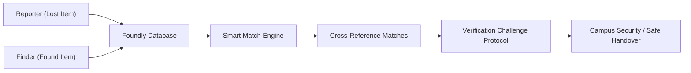
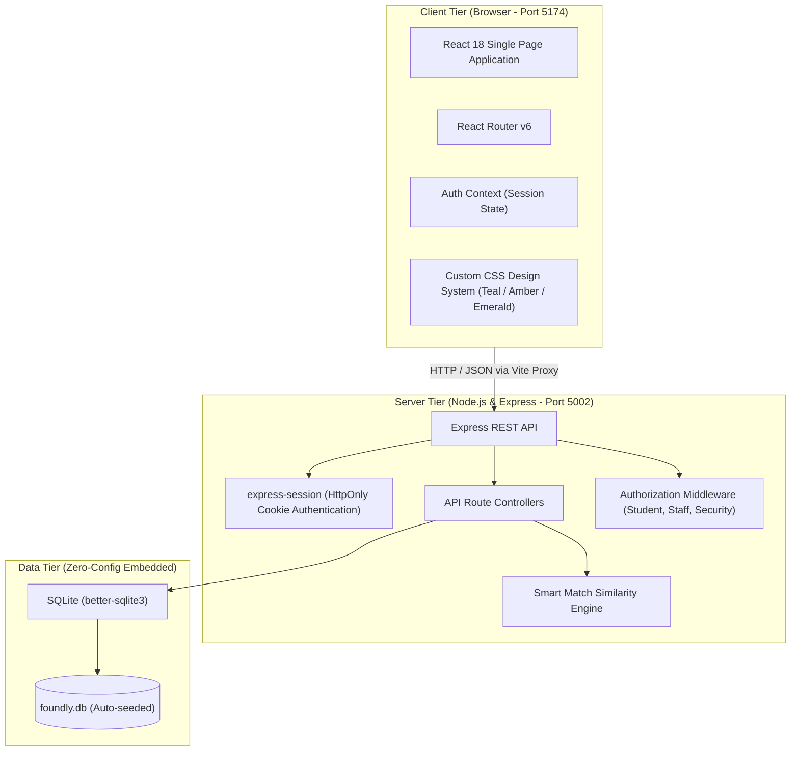
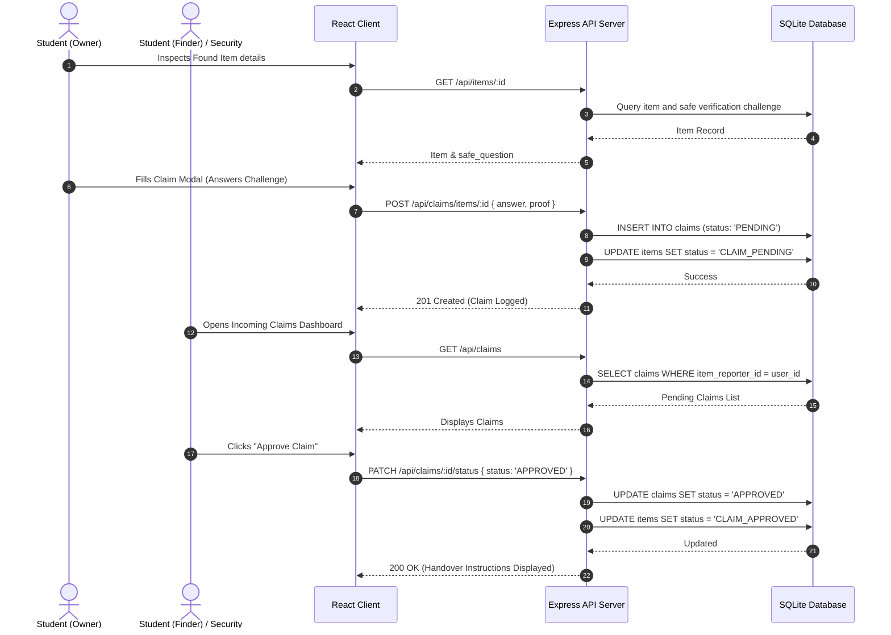
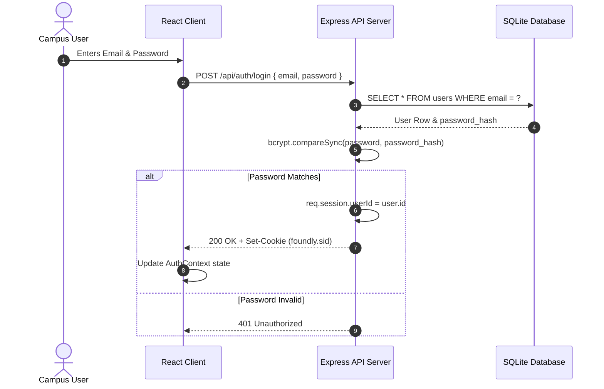
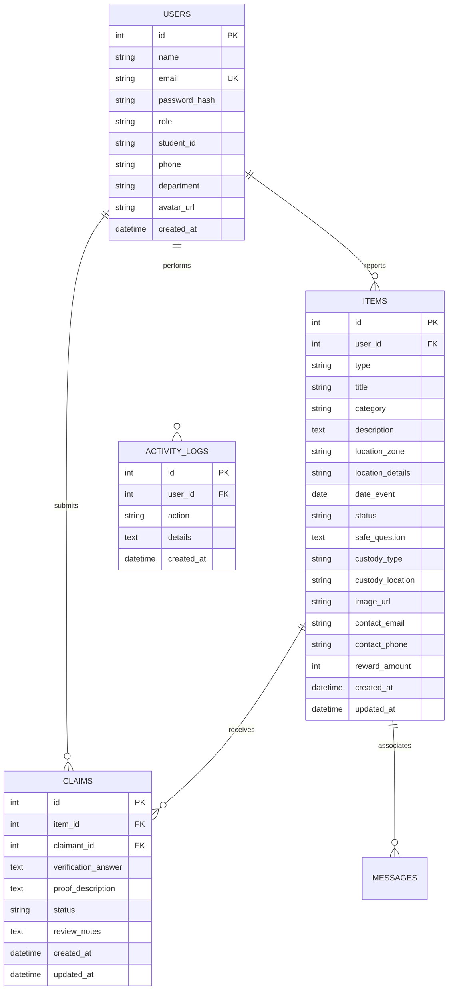

# Foundly — Comprehensive Project Documentation & Architecture Guide

> **Academic Degree Context:** Undergraduate Computer Science & Engineering Capstone / Software Engineering Project  
> **Project Title:** Foundly (Smart Campus & Community Lost and Found Management Platform)  
> **Repository:** `foundly-lost-and-found`  
> **Author / Maintainer:** Foundly Academic Project Team  
> **Target Audience:** Evaluators, University Viva Examiners, Project Supervisors, and Contributing Engineers  

---

## Table of Contents
1. [Executive Summary & Motivation](#1-executive-summary--motivation)
2. [High-Level System Architecture](#2-high-level-system-architecture)
3. [Deep-Dive Feature Explanation](#3-deep-dive-feature-explanation)
4. [System Workflows & Sequence Diagrams](#4-system-workflows--sequence-diagrams)
5. [Database Design & Data Dictionary](#5-database-design--data-dictionary)
6. [Algorithmic Deep-Dive: Smart Match Engine](#6-algorithmic-deep-dive-smart-match-engine)
7. [Complete REST API Specification](#7-complete-rest-api-specification)
8. [Installation, Environment & Execution Guide](#8-installation-environment--execution-guide)
9. [University Viva & Presentation Defense Guide (20 Q&A)](#9-university-viva--presentation-defense-guide)

---

## 1. Executive Summary & Motivation

### 1.1 The Academic Problem
On modern academic campuses hosting tens of thousands of active students and staff, valuable personal property is regularly misplaced:
- **High-Value Assets:** Laptops, tablets, wireless headphones, and smartphones containing critical academic coursework, thesis projects, and credentials.
- **Sensitive Identification:** Student ID cards, driver's licenses, transit passes, and room keys.
- **Academic Gear:** Graphing calculators, lab notebooks, textbooks, and backpacks.

Traditional lost-and-found methods suffer from critical vulnerabilities:
1. **Unverified Claims & Theft:** When an item is advertised on an open social media board or public chat, unscrupulous individuals can claim ownership without verification.
2. **Asymmetric Information:** The student who lost an item at 2:00 PM in the library rarely knows that a student found it at 5:00 PM and handed it to the second-floor library desk.
3. **Disorganized Physical Custody:** Campus safety officers rely on paper logs that do not support keyword search, category filtering, or automated alerts.

### 1.2 The Foundly Solution
**Foundly** addresses these challenges through a secure, structured web portal:
- **Bi-Directional Incident Reporting:** Dedicated flows for logging lost items vs found items.
- **Automated Smart Similarity Matching:** Algorithmic scoring that cross-references categories, campus zones, keywords, and incident timestamps.
- **Private Verification Challenges:** Finders specify security questions (e.g., *"What sticker is on the back?"*) that only true owners can answer before custody transfers.
- **Central Custody Tracking:** Real-time visibility into items held in physical security safes, student union desks, or with finders.



---

## 2. High-Level System Architecture

Foundly follows a modern **Three-Tier Client-Server Architecture** designed for zero-configuration deployment and academic evaluation:



### Technology Justification

| Layer | Technology | Justification for Selection |
| :--- | :--- | :--- |
| **Frontend Framework** | React 18 | Component-based state management, declarative rendering, and widespread industry adoption. |
| **Build Tooling** | Vite v6 | Instant Hot Module Replacement (HMR), sub-second build times, and zero-overhead dev server. |
| **Routing** | React Router v6 | Declarative client-side routing with clean URL parameter handling and history support. |
| **Icons** | Lucide React | Feather-based lightweight vector icons for responsive UI components. |
| **Backend Runtime** | Node.js (v20+ / v22) | High-performance non-blocking asynchronous event loop with native ES module and CommonJS support. |
| **Web Server** | Express v4 | Minimalist, robust REST API framework with proven middleware architecture. |
| **Database Engine** | SQLite (`better-sqlite3`) | Embedded, zero-configuration SQL database engine. Eliminates external database server dependencies (e.g., PostgreSQL/MySQL setup failures during viva examinations). |
| **Security** | `bcryptjs` + `express-session` | Industry-standard salt hashing for passwords and secure `HttpOnly` cookie-based session management. |

---

## 3. Deep-Dive Feature Explanation

### 3.1 Dual-Mode Incident Reporting
Users can initiate reports under two distinct modalities:
1. **`LOST` Item Flow:**
   - Captures title, category, incident timestamp, campus zone (e.g., *Main Library*, *Student Cafeteria*, *Science Complex*), specific location details, and optional recovery reward amount.
2. **`FOUND` Item Flow:**
   - Captures found property details and **Verification Challenge Question** (e.g., *"What is written on the keychain tag?"*).
   - Records physical custody location (e.g., *Held by Finder* vs *Deposited at Campus Security Desk #104*).

### 3.2 Verification Challenge & Claim Workflow
To eliminate fraudulent claims:
1. An owner inspecting a found item clicks **"Claim This Item"**.
2. The user is prompted to answer the finder's security challenge question and optionally provide supplemental proof (serial number, purchase receipt, or unique scratches).
3. The claim transitions to `PENDING`.
4. The item reporter (or campus security officer) reviews the submitted answer in their dashboard.
5. If verified, the reviewer approves the claim and logs the handover. The item status transitions to `RETURNED`.

---

## 4. System Workflows & Sequence Diagrams

### 4.1 Claim Submission & Verification Flow



### 4.2 User Authentication Flow



---

## 5. Database Design & Data Dictionary

### 5.1 Entity Relationship Diagram (ERD)



### 5.2 Data Dictionary

#### Table: `users`
| Column | Type | Constraints | Description |
| :--- | :--- | :--- | :--- |
| `id` | INTEGER | PRIMARY KEY AUTOINCREMENT | Unique user identifier |
| `name` | TEXT | NOT NULL | User's full name |
| `email` | TEXT | UNIQUE, NOT NULL | University campus email address |
| `password_hash` | TEXT | NOT NULL | Bcrypt hashed secret password |
| `role` | TEXT | DEFAULT 'student' | Role (`student`, `staff`, `security`, `admin`) |
| `student_id` | TEXT | NULLABLE | University student registration number |
| `phone` | TEXT | NULLABLE | Contact telephone for handover coordination |
| `department` | TEXT | NULLABLE | Academic school or faculty |
| `avatar_url` | TEXT | NULLABLE | Profile picture URL |
| `created_at` | DATETIME | DEFAULT CURRENT_TIMESTAMP | Account creation timestamp |

#### Table: `items`
| Column | Type | Constraints | Description |
| :--- | :--- | :--- | :--- |
| `id` | INTEGER | PRIMARY KEY AUTOINCREMENT | Unique item identifier |
| `user_id` | INTEGER | FK -> users(id) ON DELETE CASCADE | Reporter user reference |
| `type` | TEXT | CHECK IN ('LOST', 'FOUND') | Incident classification |
| `title` | TEXT | NOT NULL | Concise headline (e.g., MacBook Pro) |
| `category` | TEXT | NOT NULL | Asset category (Electronics, IDs, Keys, etc.) |
| `description` | TEXT | NOT NULL | Physical description, colors, stickers, flaws |
| `location_zone` | TEXT | NOT NULL | Standard campus zone (Library, Cafeteria, etc.) |
| `location_details` | TEXT | NULLABLE | Specific room or table number |
| `date_event` | DATE | NOT NULL | Date property was lost or found |
| `status` | TEXT | DEFAULT 'REPORTED' | Status (`REPORTED`, `MATCH_SUGGESTED`, `CLAIM_PENDING`, `CLAIM_APPROVED`, `RETURNED`) |
| `safe_question` | TEXT | NULLABLE | Challenge question set by finder |
| `custody_type` | TEXT | DEFAULT 'WITH_FINDER' | Storage state (`WITH_FINDER`, `CAMPUS_SECURITY_DESK`, `STUDENT_UNION_OFFICE`, `RETURNED`) |
| `custody_location` | TEXT | NULLABLE | Specific physical office or locker number |
| `reward_amount` | INTEGER | DEFAULT 0 | Recovery reward in USD offered by owner |

---

## 6. Algorithmic Deep-Dive: Smart Match Engine

When an item $I_{target}$ is inspected, Foundly's Smart Match Engine evaluates all active items $C \in \text{Items}$ of the opposite modality ($T_C \neq T_{target}$) where status $\neq \text{RETURNED}$.

The total composite similarity score $S(I_{target}, C) \in [0, 100]$ is computed as:

$$S(I_{target}, C) = S_{\text{cat}} + S_{\text{zone}} + S_{\text{keywords}} + S_{\text{date}}$$

Where:
1. **Category Weight ($S_{\text{cat}}$):**
   $$S_{\text{cat}} = \begin{cases} 40, & \text{if } \text{Category}(I_{target}) = \text{Category}(C) \\ 0, & \text{otherwise} \end{cases}$$

2. **Campus Zone Weight ($S_{\text{zone}}$):**
   $$S_{\text{zone}} = \begin{cases} 30, & \text{if } \text{Zone}(I_{target}) = \text{Zone}(C) \\ 0, & \text{otherwise} \end{cases}$$

3. **Keyword Overlap Weight ($S_{\text{keywords}}$):**
   Let $K_1 = \text{Tokenize}(I_{target})$ and $K_2 = \text{Tokenize}(C)$ with stopword filtering.
   $$S_{\text{keywords}} = \min(20, |K_1 \cap K_2| \times 7)$$

4. **Temporal Proximity Weight ($S_{\text{date}}$):**
   Let $\Delta d = |\text{Date}(I_{target}) - \text{Date}(C)|$ in days.
   $$S_{\text{date}} = \begin{cases} 10, & \text{if } \Delta d \le 3 \\ 5, & \text{if } 3 < \Delta d \le 7 \\ 0, & \text{otherwise} \end{cases}$$

Candidate pairs scoring $S \ge 35$ are flagged as potential matches, sorted in descending order of confidence, and displayed to users for one-click cross-verification.

---

## 7. Complete REST API Specification

### Authentication Endpoints
- `GET /api/auth/me` — Returns session user payload or `{ user: null }`.
- `POST /api/auth/login` — Verifies email/password; returns user and sets session cookie.
- `POST /api/auth/register` — Validates uniqueness, hashes password, and creates session.
- `POST /api/auth/logout` — Destroys session and clears cookie.
- `GET /api/auth/demo-users` — Returns demo user directory for testing.

### Item Management Endpoints
- `GET /api/items` — Query items with filters: `type`, `category`, `zone`, `status`, `search`, `my_items`.
- `GET /api/items/:id` — Returns single item details, reporter profile, and associated claims.
- `POST /api/items` — Authenticated report creation; triggers automatic audit logging.
- `PATCH /api/items/:id/status` — Updates item status or transitions custody.
- `DELETE /api/items/:id` — Removes item (restricted to owner or campus security).

### Matching & Claims Endpoints
- `GET /api/matches/:id` — Executes similarity algorithm on item `:id`.
- `GET /api/claims` — Retrieves user's submitted claims and incoming claims on their items.
- `POST /api/claims/items/:id` — Submits an ownership claim with challenge answer and proof.
- `PATCH /api/claims/:id/status` — Evaluates claim (`APPROVED`, `REJECTED`, `HANDOVER_COMPLETED`).

### Analytics Endpoints
- `GET /api/stats/overview` — Aggregates total counts, recovery rate percentage, category distributions, zone hotspots, and live audit feed.

---

## 8. Installation, Environment & Execution Guide

### Prerequisites
- Node.js v20.x or v22.x (`node -v`)
- npm v10.x (`npm -v`)

### Commands
```bash
# Clone
git clone git@github.com:s-mithila/foundly-lost-and-found.git
cd foundly-lost-and-found

# Install dependencies (Single root package for Client + Server)
npm install

# Start both backend (Port 5002) and frontend (Port 5174) concurrently
npm run dev

# Reset and re-seed database at any time
npm run db:reset

# Compile production frontend bundle
npm run build
```

---

## 9. University Viva & Presentation Defense Guide

### 20 High-Scoring Viva Questions & Answers

#### Q1: What is the primary problem Foundly solves compared to a social media group?
**Answer:** Social media groups lack structured search, invite false ownership claims because found items are publicly revealed, have zero custody tracking, and posts quickly drown in chat noise. Foundly introduces structured campus zone categorization, safe verification challenge questions, and formal custody management.

#### Q2: Why did you choose SQLite over PostgreSQL or MongoDB for this project?
**Answer:** SQLite via `better-sqlite3` runs synchronously in-process with zero external server dependencies, ensuring that examiners and supervisors can clone and run the application instantly with a single command without configuring local database server daemons.

#### Q3: How does Foundly prevent fraudulent claims on found items?
**Answer:** Finders do not disclose all distinguishing features in the public description; instead, they define a **Safe Verification Challenge Question** (e.g., *"What sticker is on the back lid?"*). True owners must correctly answer this challenge when filing a claim before handover approval.

#### Q4: How does the Smart Match Engine calculate similarity?
**Answer:** It applies a weighted multi-factor scoring formula: Category match (40%), Location Zone match (30%), Title/Description keyword overlap (up to 20%), and Date proximity within 3–7 days (up to 10%). Matches scoring $\ge 35\%$ are presented as potential matches.

#### Q5: How is user authentication secured?
**Answer:** User passwords are encrypted with `bcryptjs` using 10 salt rounds before database persistence. Sessions are managed using `express-session` with secure `HttpOnly` cookies, preventing client-side Cross-Site Scripting (XSS) token exfiltration.

#### Q6: How does Foundly prevent a user from claiming their own item?
**Answer:** The claim controller (`POST /api/claims/items/:itemId`) enforces a business logic check: `if (item.user_id === req.user.id) return 400 Bad Request`.

#### Q7: What roles are supported in the system?
**Answer:** Four roles: `student`, `staff`, `security`, and `admin`. Security and admin roles have administrative authority to review claims across all items, update custody locations to the Central Security Safe, and log handovers.

#### Q8: How does the frontend communicate with the backend in development?
**Answer:** Through Vite's built-in development proxy (`vite.config.js`). Any request matching `/api/*` is proxied to `http://localhost:5002`, eliminating Cross-Origin Resource Sharing (CORS) preflight friction during local development.

#### Q9: What happens when a claim is approved?
**Answer:** The claim status is updated to `APPROVED`, and the corresponding item status transitions to `CLAIM_APPROVED`. Once physical pickup occurs, the reviewer marks it as `HANDOVER_COMPLETED`, setting the item status to `RETURNED`.

#### Q10: How are audit logs maintained?
**Answer:** Critical state-changing actions (`REPORT_LOST`, `REPORT_FOUND`, `SUBMIT_CLAIM`, `CLAIM_APPROVED`, `ITEM_RETURNED`) execute an atomic `INSERT INTO activity_logs` statement recording the user ID, action type, description, and timestamp.

#### Q11: How does the system handle database resets?
**Answer:** Running `npm run db:reset` unlinks the SQLite file and re-runs `db.js`, which recreates the schema tables and executes `seedDatabase()` to restore realistic university demo data.

#### Q12: Why are both client and server dependencies managed in a single root `package.json`?
**Answer:** It simplifies evaluator onboarding. A single `npm install` and `npm run dev` starts the concurrent development environment without requiring multiple terminals or nested directory navigation.

#### Q13: Can Foundly run simultaneously with other local web applications?
**Answer:** Yes. Foundly uses Port `5002` for its Express backend and Port `5174` for its Vite client, ensuring zero port conflicts with applications running on default ports like `5001` or `5173`.

#### Q14: How does the UI accommodate mobile devices?
**Answer:** The CSS design system uses responsive CSS Grid and Flexbox layouts with media queries, ensuring usability across smartphones, tablets, and desktop workstations.

#### Q15: How are sensitive contact details handled?
**Answer:** A student's personal phone number is only shared with authorized parties during approved claim coordination, protecting privacy while maintaining communication channels.

#### Q16: What is the recovery rate metric and how is it calculated?
**Answer:** Recovery Rate is the percentage of all reported campus incidents that have been resolved and safely returned to owners: $\text{Recovery Rate} = \frac{\text{Returned Items}}{\text{Total Items}} \times 100\%$.

#### Q17: What stopword filter is implemented in the keyword matcher?
**Answer:** A hash set filtering common English words (*the*, *and*, *with*, *for*, *near*, *left*, *floor*, *area*) ensures similarity scoring focuses on distinctive descriptive terms.

#### Q18: What visual design principles distinguish Foundly's UI?
**Answer:** Foundly utilizes a high-contrast Forest Teal and Mint palette for safety and discovery, contrasted with Warm Amber for Lost alerts, crisp card borders, and responsive pill badges.

#### Q19: How are images handled without external cloud storage dependencies?
**Answer:** The system accepts image URLs and provides built-in high-resolution category photo presets, ensuring reliable rendering without requiring paid AWS S3 or Cloudinary API keys during academic grading.

#### Q20: What are potential future enhancements for Foundly?
**Answer:** 
1. Real-time WebSocket notifications for instant match alerts.
2. AI-powered image similarity comparison using computer vision embeddings.
3. QR code tag generation for student belongings to facilitate instant scanning upon discovery.
