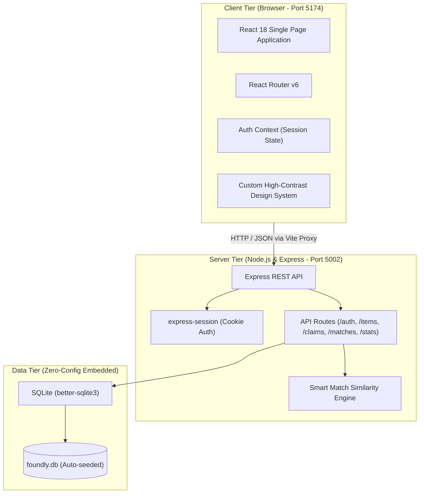

# Foundly — Smart Campus & Community Lost and Found Platform

> **A modern, responsive web application engineered for university campuses and communities to report lost items, register found property, and securely reunite owners using smart attribute matching and verification challenges.**


---

## 🎯 1. Project Overview & Problem Statement

### The Problem
On active university campuses, thousands of valuable personal items—laptops, AirPods, student ID cards, keys, wallets, calculators, and winter jackets—are misplaced each semester across libraries, lecture halls, gyms, and cafeterias. However:
1. **Disjointed Channels:** Reports are scattered across unstructured social media groups, fragmented WhatsApp chats, or physical bulletin boards that expire or get lost in noise.
2. **Fraudulent / False Claims:** Openly advertising that an expensive item (e.g., a MacBook or wallet) was found invites dishonest claims, as finders lack a systematic way to verify genuine ownership before handing items over.
3. **Inefficient Custody Tracking:** Campus security officers and building attendants struggle to maintain handwritten paper logbooks of items deposited in campus safes.

### The Solution: Foundly
**Foundly** is an open, unified campus lost-and-found management ecosystem featuring:
- **Dual Incident Reporting:** File detailed reports for either `LOST` or `FOUND` items categorized by campus zones, timestamps, and physical descriptions.
- **Automated Smart Matching Engine:** Cross-references lost and found entries in real-time, scoring similarity across category (+40%), location zone (+30%), keyword overlap (+20%), and date proximity (+10%).
- **Verification Challenge Protocol:** Finders specify a private security question (e.g., *"What sticker is on the lid?"* or *"What is the engraved initials?"*). Claimants must answer the challenge and provide identifying proof before handovers are approved.
- **Campus Custody Management:** Tracks custody status (`With Finder`, `Campus Security Safe`, or `Returned`) and maintains an immutable audit log of all incident resolutions.

> 📖 **Comprehensive Academic Documentation:** For deep-dive architectural breakdowns, sequence diagrams, database dictionary, and university viva preparation, see [DOCUMENTATION.md](./DOCUMENTATION.md).

---

## 🚀 2. Quick Start & Installation

Foundly is designed for effortless evaluation: **one single root package file, zero configuration files, and zero external database setup required.**

### Prerequisites
- [Node.js](https://nodejs.org/) v20 or newer (`node -v`)
- npm v10 or newer (`npm -v`)

### 1-Command Installation & Run

```bash
# 1. Clone the repository
git clone git@github.com:s-mithila/foundly-lost-and-found.git
cd foundly-lost-and-found

# 2. Install all dependencies (Frontend + Backend in one step)
npm install

# 3. Start the application
npm run dev
```

Then open your browser at:  
👉 **[http://localhost:5174](http://localhost:5174)**

*(The Express REST API server automatically starts on port `5002`, and Vite runs the client on port `5174`, proxied so both can run concurrently alongside other local projects).*

---

## 🔑 3. Demo Credentials

Foundly comes pre-seeded with sample university students, campus security officers, and realistic lost/found items. For university presentations and viva evaluations, click the **"Demo Profiles"** dropdown in the navigation bar or use the **"Autofill"** buttons on the Login page:

| Role | Name | Email | Password | Pre-loaded Context |
| :--- | :--- | :--- | :--- | :--- |
| **Student (Reporter)** | Sarah Jenkins | `sarah.jenkins@campus.edu` | `password123` | Reported lost M2 MacBook Pro & AirPods |
| **Student (Finder)** | Alex Chen | `alex.chen@campus.edu` | `password123` | Found laptop in Library & Car Key at Transit |
| **Student** | Marcus Vance | `marcus.vance@campus.edu` | `password123` | Lost wallet at cafeteria; returned jacket |
| **Campus Security Officer** | Officer Robert Davis | `security.davis@campus.edu` | `password123` | Central Security Desk custodian & claim approver |

---

## 🏗️ 4. System Architecture



---

## ✨ 5. Core Features

### 🔍 1. Interactive Item Catalog & Filtering
- Multi-dimensional filtering by **Type** (`LOST` vs `FOUND`), **Category** (Electronics, Keys & Wallets, IDs, Bags, Books, Clothing, Essentials), **Campus Zone** (Library, Science Complex, Cafeteria, Sports Gym, Transit), and **Status**.
- Full-text keyword search across item titles, descriptions, and specific locations.

### ⚡ 2. Automated Smart Matching Engine
- Whenever a user inspects an item, the system scans all opposite items and calculates a match confidence percentage based on weighted factors:
  - Identical Category: **+40 points**
  - Same Campus Zone: **+30 points**
  - Shared Keywords in Title & Description: **up to +20 points**
  - Date Proximity (within 3–7 days): **up to +10 points**
- Displays match scores (e.g., *90% Match: Lost MacBook Pro ↔ Found Space Gray Laptop*) with clickable inspect links.

### 🛡️ 3. Safe Verification Challenge & Claim Workflow
- Finders set a challenge question that only the true owner can answer.
- Claimants submit proof descriptions (serial numbers, wallpapers, receipts, identifying stickers).
- Reporters or Campus Security Officers review claims with one-click **Approve**, **Reject**, or **Complete Handover**.

### 📊 4. Campus Safety & Recovery Analytics
- Real-time statistics: Total items tracked, recovery rate percentage, items currently secured in the Central Security Safe, and active pending claims.
- Category distribution and high-frequency loss zone rankings.
- Immutable live incident audit log.

---

## 📂 6. Project Directory Structure

```
foundly-lost-and-found/
├── package.json              # Single root package for both client & server
├── vite.config.js            # Vite configuration (port 5174, proxy to 5002)
├── .gitignore                # Ignored directories (node_modules, db, dist)
├── .nvmrc                    # Recommended Node version (v22 / v20+)
├── README.md                 # Project overview and quick start guide
├── DOCUMENTATION.md          # Comprehensive academic architecture & viva guide
├── server/                   # Backend Express Application
│   ├── server.js             # Server entry point & CORS/session setup
│   ├── middleware/
│   │   └── auth.js           # Session auth & security role authorization
│   ├── database/
│   │   ├── schema.sql        # SQLite schema definition
│   │   ├── seed.js           # Pre-loaded university demo dataset
│   │   ├── db.js             # better-sqlite3 initialization
│   │   └── reset.js          # npm run db:reset script
│   └── routes/
│       ├── auth.js           # Registration, login, logout, demo profiles
│       ├── items.js          # CRUD & filtering for lost/found items
│       ├── claims.js         # Claim submissions, status evaluation
│       ├── matches.js        # Smart Match scoring algorithm
│       └── stats.js          # Campus recovery analytics
└── client/                   # Frontend React Application
    ├── index.html            # Single page entry HTML
    └── src/
        ├── main.jsx          # React DOM root render
        ├── App.jsx           # App layout & React Router v6 configuration
        ├── styles/
        │   └── main.css      # High-contrast teal/amber/emerald design system
        ├── context/
        │   └── AuthContext.jsx # Global user auth & session provider
        ├── services/
        │   └── api.js        # Fetch wrapper for Express REST API
        ├── components/
        │   ├── Navbar.jsx    # Top navigation & 1-click persona switcher
        │   ├── Footer.jsx    # Campus links & info footer
        │   ├── ItemCard.jsx  # Card preview with type & reward badges
        │   ├── StatusBadge.jsx # LOST/FOUND and custody status badges
        │   ├── CategoryIcon.jsx # Lucide icon mapper
        │   └── ClaimModal.jsx# Verification challenge submission modal
        └── pages/
            ├── HomePage.jsx       # Hero, live recovery metrics & protocol
            ├── BrowseItemsPage.jsx# Interactive catalog with filter sidebar
            ├── ItemDetailPage.jsx # Item inspect, match suggestions & claims
            ├── ReportItemPage.jsx # Dual-mode reporting form (LOST vs FOUND)
            ├── ClaimsPage.jsx     # Track submitted & received claims
            ├── DashboardPage.jsx  # Campus security analytics & audit log
            ├── LoginPage.jsx      # Login with 1-click demo autofill
            └── RegisterPage.jsx   # New user registration
```

---

## 📡 7. REST API Reference

| Method | Endpoint | Access | Description |
| :--- | :--- | :--- | :--- |
| `GET` | `/api/auth/me` | Public | Return current session user |
| `POST` | `/api/auth/login` | Public | Authenticate user credentials |
| `POST` | `/api/auth/register` | Public | Register new campus account |
| `POST` | `/api/auth/logout` | Session | Destroy active session |
| `GET` | `/api/auth/demo-users` | Public | List available demo accounts |
| `GET` | `/api/items` | Public | Filter items by type, category, zone, status |
| `GET` | `/api/items/:id` | Public | Get item details, claims, and reporter info |
| `POST` | `/api/items` | Authenticated | Create a new lost or found report |
| `PATCH` | `/api/items/:id/status`| Custodian | Update item status or transfer custody |
| `DELETE`| `/api/items/:id` | Custodian | Delete item record |
| `GET` | `/api/matches/:id` | Public | Run smart matching engine on item |
| `GET` | `/api/claims` | Authenticated | Fetch submitted & received claims |
| `POST` | `/api/claims/items/:id`| Authenticated | Submit ownership claim with proof |
| `PATCH` | `/api/claims/:id/status`| Custodian | Approve, reject, or complete handover |
| `GET` | `/api/stats/overview` | Public | Return recovery rates & zone metrics |

---

## 🛠️ 8. Useful NPM Scripts

```bash
npm run dev        # Run both Express server and Vite client concurrently
npm run server     # Run only the backend Express API server
npm run client     # Run only the Vite frontend dev server
npm run build      # Compile production frontend bundle into dist/
npm run preview    # Preview compiled production build locally
npm run db:reset   # Wipe SQLite database and restore fresh demo dataset
```

---

## 📄 9. License

This project is open-source and released under the **MIT License**.
